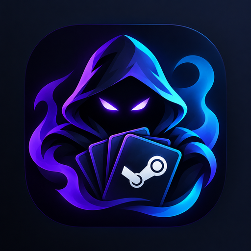
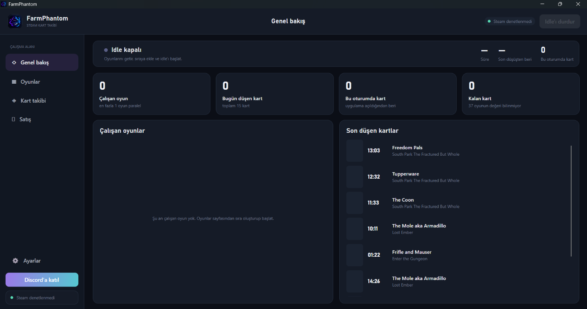
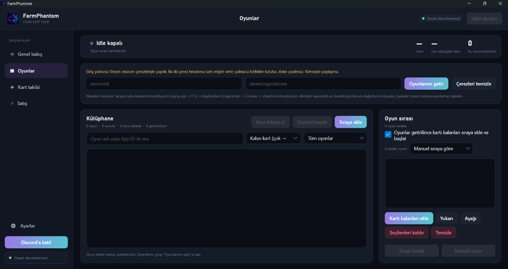
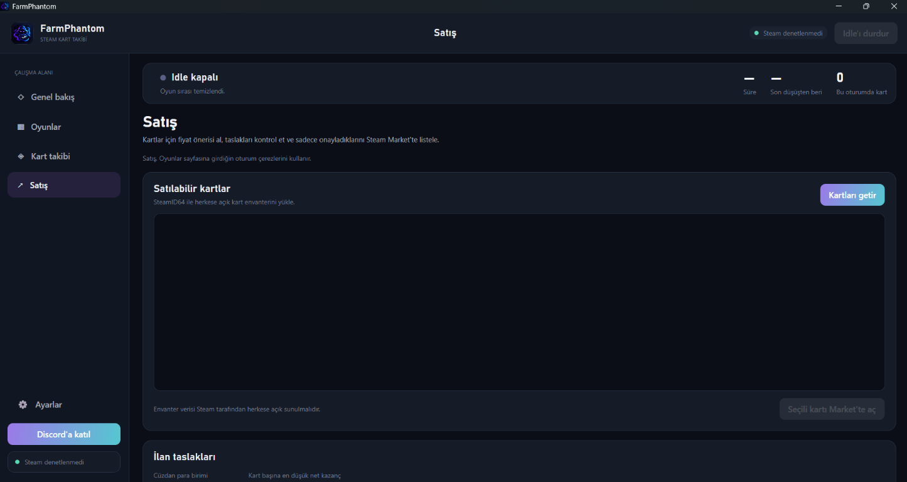

<p align="center">
  
</p>

<h1 align="center">FarmPhantom</h1>

<p align="center">
  <strong>Kart düşsün, sen onayla.</strong><br />
  Steam kartlarını farm’la, gerçek düşüşleri takip et ve Market ilanlarını yalnızca sen onaylayınca yayınla.
</p>

<p align="center">
  <em>Bu benim ilk uygulamam; geri bildirim ve fikirlerini duymayı çok isterim.</em>
</p>

<p align="center">
  
  
  
  <a href="LICENSE"></a>
</p>

<p align="center">
  <a href="docs/">Proje sitesi</a> ·
  <a href="LICENSE">Lisans</a>
  · <a href="CHANGELOG.md">Sürüm notları</a> ·
  <a href="https://discord.gg/Ny9NxMwTHj">Discord</a>
</p>

<p align="center">
  <em>Windows için açık kaynak Steam kart takip aracı · Türkçe ve İngilizce</em>
</p>

---

| 🎮 Çoklu oyun idle | 📊 Gerçek düşüş takibi | 🛒 Onaylı Market taslakları |
|:--|:--|:--|
| Birden fazla oyunu sıraya koy, çalışma sırasını ve eşzamanlı oyun sayısını seç. | Yalnızca idle edilen oyundan gelen kartları say; geçmişi ve tahmini değeri görüntüle. | Fiyatları çekip ilan taslağı hazırla. Sen onaylamadan hiçbir şey listelenmez. |

> **Gizlilik öncelikli:** Steam çerezleri diske veya Discord’a gönderilmez. İsteğe bağlı bot tokenı Windows DPAPI ile korunur.

### Hızlı başla

1. [.NET 10 SDK](https://dotnet.microsoft.com/download/dotnet/10.0) kur.
2. Resmi `steam_api64.dll` dosyasını `app/` içine ekle (Steamworks lisansı nedeniyle depoda bulunmaz).
3. Uygulamayı çalıştır:

```
cd app
dotnet run
```

> İlk kurulum, Steam çerezleri, Discord ve güvenlik notları için aşağıdaki ayrıntılı kılavuza bak.

---

## Ekran görüntüleri

<table>
  <tr>
    <td align="center"><a href="docs/assets/screenshot-overview.png"></a><br />Genel bakış / Overview</td>
    <td align="center"><a href="docs/assets/screenshot-games.png"></a><br />Oyunlar ve sıra / Games and queue</td>
    <td align="center"><a href="docs/assets/screenshot-sales.png"></a><br />Kart satışı / Card sales</td>
  </tr>
</table>

## Türkçe

### Ne işe yarıyor

**Oyunlar.** Steam’e `sessionid` ve `steamLoginSecure` çerezleriyle giriyorsun. “Oyunlarımı getir” rozet sayfalarından kartı kalan oyunları çeker. Arama, filtre, kara liste, sıra ve idle buradan.

Sıra senin verdiğin sırayı izleyebilir, ya da kartı az kalan / çok kalan oyunlardan başlayabilir. İstersen oyunlar gelince kartı kalanları otomatik kuyruğa alıp idle’ı başlatır.

**Kart takibi.** Envanter arada bir okunur. Düşüş olarak yalnızca o anda idle ettiğin oyunun kartı sayılır. Takastan veya başka yerden gelen kartlar buraya yazılmaz. Geçmiş, günlük özet ve kaba bir değer tahmini de bu sayfada.

Aynı anda 1–32 oyun çalıştırabilirsin.

**Satış.** Market fiyatını çeker, taslak ilan çıkarır. Onaylamadan hiçbir şey listelenmez. “Kart başına en düşük net kazanç” Steam komisyonundan sonra cebine kalacak tutardır.

**Ayarlar.** Steamworks DLL durumu, isteğe bağlı Discord botu, Rich Presence, dil.

Diller: Türkçe, İngilizce, Almanca, Fransızca, İspanyolca, İtalyanca, Brezilya Portekizcesi, Rusça, Basitleştirilmiş Çince, Japonca, Korece, Arapça. Türkçe ve İngilizce tam. Diğerlerinde henüz çevrilmemiş mesajlar İngilizceye düşer. Yeni dil için `app/Locales` altına JSON atman yeterli. Arapça gibi sağdan sola dillerde yön kendiliğinden döner.

### Kurulum

1. .NET 10 SDK kur.
2. Resmi `steam_api64.dll` dosyasını `app/` içine koy. Steamworks.NET’in Standalone paketinden veya Steamworks SDK’dan al. Lisans yüzünden bu dosya repoda yok. Steam açık olsun, idle edeceğin oyunlar da o hesapta olsun.
3. `app` klasöründe `dotnet run`.

Tek exe için:

```
dotnet publish -c Release -r win-x64
```

Yanına yine `steam_api64.dll` koyman lazım.

Paylaşılacak ZIP için PowerShell’de `.\scripts\Package-Windows.ps1`. Çıktı `dist/` altına gider.

Kurulum dosyası hazırlamak için Inno Setup 6’yı kurup `.\scripts\Package-Windows.ps1 -IncludeInstaller -AppVersion 1.0.0` çalıştır. `dist/` içine ZIP’in yanında `FarmPhantom-Setup-win-x64.exe` gelir. Setup .NET’i kendi içinde taşır; ayrıca .NET kurdurmaz. İlk açılışta resmi `steam_api64.dll` dosyasını seçmen istenir. Dosya setup’a eklenmez; Steam’i de setup kurmaz. Steam’in bilgisayarda kurulu ve açık olması gerekir.

### Çerezler

steamcommunity.com’a tarayıcıdan gir → F12 → Application / Uygulama → Cookies → `steamcommunity.com` → `sessionid` ve `steamLoginSecure`.

Bunlar hesap anahtarı gibi. Kimseyle paylaşma. Süresi dolunca yenile.

### Discord (opsiyonel)

`app/BrandConfig.cs` içinde Rich Presence uygulama ID’si, davet linki ve proje linki duruyor. Boş bırakırsan ilgili buton / Presence çıkmaz.

Presence için discord.com/developers’ta bir uygulama aç, ID’yi yapıştır, Art Assets’e `logo` adıyla görsel yükle. Ayarlardan açılır. Presence butonlarını Discord’da sen kendi profilinde göremezsin, başkaları görür. Davet linkini süresiz ve sınırsız kullanımlı yap.

Kendi botun için:

1. Developer Portal’da bot oluştur. `bot` ve `applications.commands` ile kendi sunucuna ekle.
2. FarmPhantom → Ayarlar → tokenı yaz → Botu bağla. Token bu Windows hesabına özel, DPAPI ile şifreli durur.
3. O sunucunun sahibi `/bagla` ile kendini bot sahibi kaydeder. İlk eşlemeyi yalnızca sunucu sahibi yapabilir.

FarmPhantom açıkken bot da açık. Çıkınca bot düşer. Kart bildirimleri sahibin DM’ine gider. `/durum`, `/baslat`, `/durdur`, `/sira`, `/sonraki`, `/istatistik` yine yalnızca sahibin açık uygulamasını çevirir.

Başka üyelerin hesabını bağlama, başkasının kartını iletme yok. Satış uzaktan yok. Steam çerezleri diske yazılmaz, Discord’a da gitmez.

### Kart nasıl sayılıyor

Envanter çerezle okunur, gizli envanter de dahil. Her turda rozet sayfasından kalan düşüş de bakılır. Sıfırsa oyun bekletilmeden biter. Sayfa okunamazsa, ya da kart kalmışken senin verdiğin süre (20–90 dk) boyunca hiç kart gelmezse oyun atlanır. Steam envanteri bazen birkaç dakika geriden gelir.

### Diskte ne kalıyor

`%LOCALAPPDATA%\FarmPhantom`

- `settings.json` — sıra, süreler, paralel oyun, filtre, para birimi, Presence, dil
- `blacklist.json`, `nameids.json`, `drops.jsonl`
- `discord-bot.json` — şifreli bot tokenı ve sahip Discord ID’si

İlk Windows bildiriminde Başlat menüsüne `FarmPhantom.lnk` düşer. Bildirimin kaynağı FarmPhantom görünsün diye; MSIX falan kurmaz.

### Satış ve Steam

Kartları seç → fiyatları çek → fiyatı düzelt → satır satır Onayla → Onaylananları listele → özet pencerede bir kez daha onay.

Steam Guard mobilde açıksa telefonda da onay isteyebilir. İsteklerin arasında bekleme var; Steam rate limit’e takılırsa uygulama durur.

Sahte “şu an oynuyor” paketi göndermiyoruz ama Steam yine de hesap kısıtlayabilir. Aynı anda çok oyun bu riski büyütür. Kendi sorumluluğun.

### Lisans

MIT, `LICENSE`. Kullanılan kütüphaneler `THIRD-PARTY-NOTICES.md`. Idle Master Extended kodu yok.

---

## English

This is my first app. I'm learning as I build it, and feedback or ideas are always welcome.

Desktop app for Steam trading card drops. It can idle several games at once, watch what actually dropped, and prepare Market listings. Nothing goes up for sale until you confirm it.

Windows, Avalonia, .NET 10. Optional personal Discord bot for DMs and a few remote commands.

Source lives in `app/`:

```
cd app
dotnet run
```

### What you get

**Games.** You sign in with Steam community cookies only: `sessionid` and `steamLoginSecure`. “Fetch my games” reads badge pages and remaining card drops. Search, filters, blacklist, queue, and idle start live here.

The queue can follow the order you set, or start from games with the fewest / most cards left. There is a checkbox to auto-queue remaining drops and start when the library loads.

**Card tracking.** Inventory is polled on a timer. A drop only counts if it belongs to a game you are idling right now. Trades and other incoming cards are ignored. History, daily / per-game totals, and a rough value estimate are on this page.

You can run 1–32 games in parallel.

**Sales.** Fetches current Market prices and builds listing drafts. Nothing is listed without your OK. “Minimum net per card” is what you keep after Steam’s cut.

**Settings.** Steamworks DLL status, optional Discord bot, Rich Presence, language.

Languages: Turkish, English, German, French, Spanish, Italian, Brazilian Portuguese, Russian, Simplified Chinese, Japanese, Korean, Arabic. Turkish and English are complete. Other packs fall back to English for missing runtime strings. Drop a JSON file in `app/Locales` to add a language. RTL (Arabic) flips layout on its own.

### Setup

1. Install the .NET 10 SDK.
2. Put the official `steam_api64.dll` in `app/`. Get it from the Steamworks.NET standalone zip or the Steamworks SDK. It is not in this repo. Steam should be running, and the games should be on that account.
3. `dotnet run` from `app`.

Single-file publish:

```
dotnet publish -c Release -r win-x64
```

Keep `steam_api64.dll` next to the exe.

For a shareable zip, run `.\scripts\Package-Windows.ps1` in PowerShell. Output goes to `dist/`.

To build a Windows installer, install Inno Setup 6 and run `.\scripts\Package-Windows.ps1 -IncludeInstaller -AppVersion 1.0.0`. This creates `dist\FarmPhantom-Setup-win-x64.exe` alongside the zip. The installer is self-contained (no separate .NET install); on first launch, users select the official `steam_api64.dll`. The installer does not bundle that licensed file or install Steam. Steam must already be installed and running.

### Cookies

Log into steamcommunity.com → F12 → Application → Cookies → `steamcommunity.com` → copy `sessionid` and `steamLoginSecure`.

Those two cookies are full access to the account. Don’t share them. Refresh when they expire.

### Discord (optional)

`app/BrandConfig.cs` holds the Rich Presence app ID, invite URL, and project URL. Leave them empty to hide the related buttons / Presence.

For Presence: new app on discord.com/developers, paste the ID, upload art as `logo`. You turn it on in Settings. Presence buttons show on other people’s view of your profile, not yours. Use a never-expire, unlimited invite.

Your own bot:

1. Create a bot, add it to your server with `bot` + `applications.commands`.
2. FarmPhantom → Settings → paste the token → Connect. It is encrypted with Windows DPAPI for this Windows user.
3. The Discord server owner runs `/bagla` once to register as bot owner. Only the server owner can do that first link.

The bot is online while FarmPhantom is running. Card DMs go to the owner. `/durum`, `/baslat`, `/durdur`, `/sira`, `/sonraki`, `/istatistik` control that owner’s open app.

No linking other members’ PCs. No forwarding someone else’s drops. No remote selling. Steam cookies never hit disk and never go to Discord.

### How drops are counted

Inventory is read with your cookies (private inventory included). Each check also reads remaining drops from the badge page. Zero remaining → game finishes immediately. If the page can’t be read, or cards remain but nothing drops within your timeout (20–90 min), the game is skipped. Steam’s inventory can lag a few minutes.

### What is stored

`%LOCALAPPDATA%\FarmPhantom`

- `settings.json` — queue, timings, parallel count, filters, currency, Presence, language
- `blacklist.json`, `nameids.json`, `drops.jsonl`
- `discord-bot.json` — encrypted bot token and owner Discord id

The first Windows toast also writes `FarmPhantom.lnk` in the Start menu so the notification source shows as FarmPhantom. It does not install an MSIX.

### Selling and Steam

Pick cards → fetch prices → edit → Approve per row → List approved → confirm again in the summary.

Steam Guard on mobile may still ask for a phone confirm. There is delay between requests; if Steam rate-limits you, the app stops.

We don’t send fake game status, but Steam can still restrict an account. High parallel idle makes that more likely. Your call, your account.

### License

MIT, see `LICENSE`. Third-party notes in `THIRD-PARTY-NOTICES.md`. No Idle Master Extended (GPL-2.0) source in this tree.
